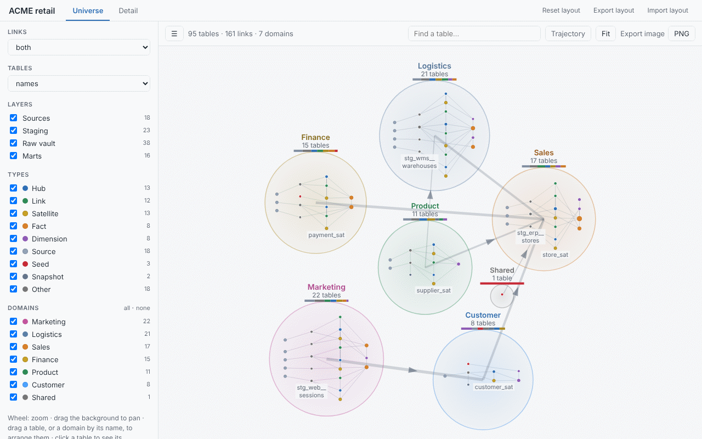
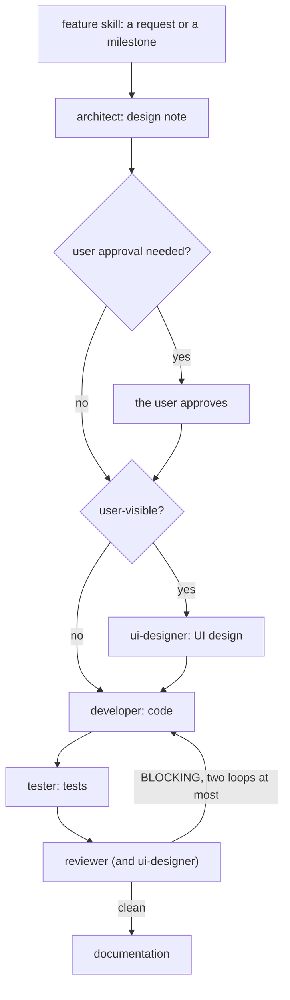

# dbtscope

Interactive map of a dbt project, in one self-contained HTML page: a **universe** view of every table grouped by data domain, and a **detail** view with the entity-relationship diagram of the tables you pick.

Warehouses built with dbt rarely declare foreign keys, so database tools draw tables with no links between them. `dbtscope` reads the dbt **manifest** instead: every `relationships` test (and every `foreign_key` constraint of a model contract) becomes a relation, drawn as a link. Which models are drawn, how they are coloured and how they are grouped is driven by naming conventions, tags, paths or schemas — Data Vault and star schema presets are built in, any other convention is a few lines of YAML.



## Quick start

Install [uv](https://docs.astral.sh/uv/) (Windows: `winget install --id=astral-sh.uv -e`; macOS: `brew install uv`; Linux: `curl -LsSf https://astral.sh/uv/install.sh | sh`; more ways in the [user guide](docs/user-guide.md#install-uv)), then:

```bash
uv tool install git+https://github.com/christophebnx/dbtscope
uv tool update-shell                 # puts dbtscope on PATH; open a new terminal afterwards
cd path/to/your/dbt/project          # the folder that holds dbt_project.yml
dbtscope --preset data_vault         # or plain dbtscope; runs dbt parse, writes erd_output/erd.html, opens it
```

The repository is private: set up git's access first ([Access to the private repository](docs/user-guide.md#access-to-the-private-repository)). No GitHub access (for example Windows without git)? Install from a wheel file: [user guide § Option C](docs/user-guide.md#option-c-from-a-wheel-file). If `dbt parse` cannot run but `target/manifest.json` exists, that manifest is mapped, with a warning. Other ways to install (SSH, a git clone, `uvx`), upgrade and uninstall: [user guide § Install](docs/user-guide.md#install).

## Documentation

- [User guide](docs/user-guide.md): [Install](docs/user-guide.md#install) (and [Upgrade](docs/user-guide.md#upgrade)), [Usage modes](docs/user-guide.md#usage-modes) (live, another folder, batch and CI, without dbt, offline page, presets), [Options](docs/user-guide.md#options), [Configuration](docs/user-guide.md#configuration) and [Selectors](docs/user-guide.md#selectors), the page ([universe](docs/user-guide.md#the-universe-view), [trajectory](docs/user-guide.md#trajectory), [flow](docs/user-guide.md#flow), [detail](docs/user-guide.md#the-detail-view), [layout](docs/user-guide.md#arranging-and-sharing-the-layout), [image export](docs/user-guide.md#exporting-images)), [Troubleshooting](docs/user-guide.md#troubleshooting) and the [FAQ](docs/user-guide.md#faq).
- [How dbtscope works](docs/how-it-works.md): the run, what is read from the manifest, how tables are classified, what the page holds, what never happens; with diagrams.
- [The example project](examples/acme_retail/): a fake but complete dbt project to try dbtscope on ([Try it on the example project](docs/user-guide.md#try-it-on-the-example-project)).
- [CHANGELOG](CHANGELOG.md): what changed, version by version.

## Configuration

Put a `dbt-erd.yml` next to `dbt_project.yml`; every key is optional. The reference of every key, presets, preset files, selectors and a walkthrough of the example's file: [user guide § Configuration](docs/user-guide.md#configuration).

## Development

Quick start (all developer commands, browser tests included, are in [`CLAUDE.md` § Commands](CLAUDE.md#commands)):

```bash
uv sync
uv run pre-commit install
uv run pytest -q -n auto -m "not live and not browser"
```

The page itself is tested in headless Chromium (`tests/browser/`, marker `browser`), excluded from the default run and from CI. Those tests need no network but a local Chromium; on a dev machine without one, run `uv run --group browser playwright install chromium` once, by hand (the tooling never runs it, D-019).

The example project `examples/acme_retail/` is also a test input: its `dbt parse` manifest is committed in `tests/fixtures/acme_retail/`, and a check against a fresh `dbt parse` runs when `DBTSCOPE_DBT` names a dbt with dbt-duckdb (D-033).

How the code is built (the run, the layers and their allowed imports, the responsibility map): [`docs/architecture.md`](docs/architecture.md). Why: [`docs/decisions.md`](docs/decisions.md). CI runs on Ubuntu, Windows and macOS (D-043, D-044, `.github/workflows/ci.yml`).

### Working with Claude Code

The repository carries a [Claude Code](https://claude.com/claude-code) workflow: project rules in `CLAUDE.md` (and one per package), agents in `.claude/agents/` (architect, ui-designer, developer, tester, reviewer, documentation), skills in `.claude/skills/` (`/feature`, `/build-roadmap`, `/release`, `/add-fixture`, `/add-decision`), and hooks that keep secrets and `main` safe. Every change goes through `/feature <request or milestone>` ([`.claude/skills/feature/SKILL.md`](.claude/skills/feature/SKILL.md)):



Quality gates: the commit-msg check, pre-commit (ruff, duplicate code, gitleaks) and the CI, `tools/ci.py` (`ruff check` and the default tests), run locally before every push; the GitHub workflow runs it only when started by hand (D-053).

## Licence

Not yet licensed: the licence is being discussed with the owner of the work (D-046). Until then no licence is granted. The JavaScript libraries embedded in offline pages keep their own licences, listed in [`src/dbtscope/render/vendor/README.md`](src/dbtscope/render/vendor/README.md).
