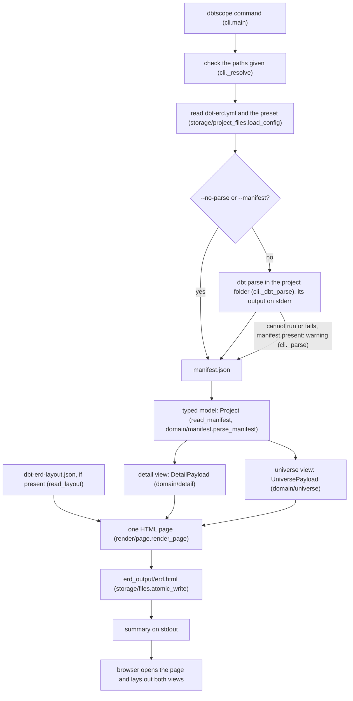
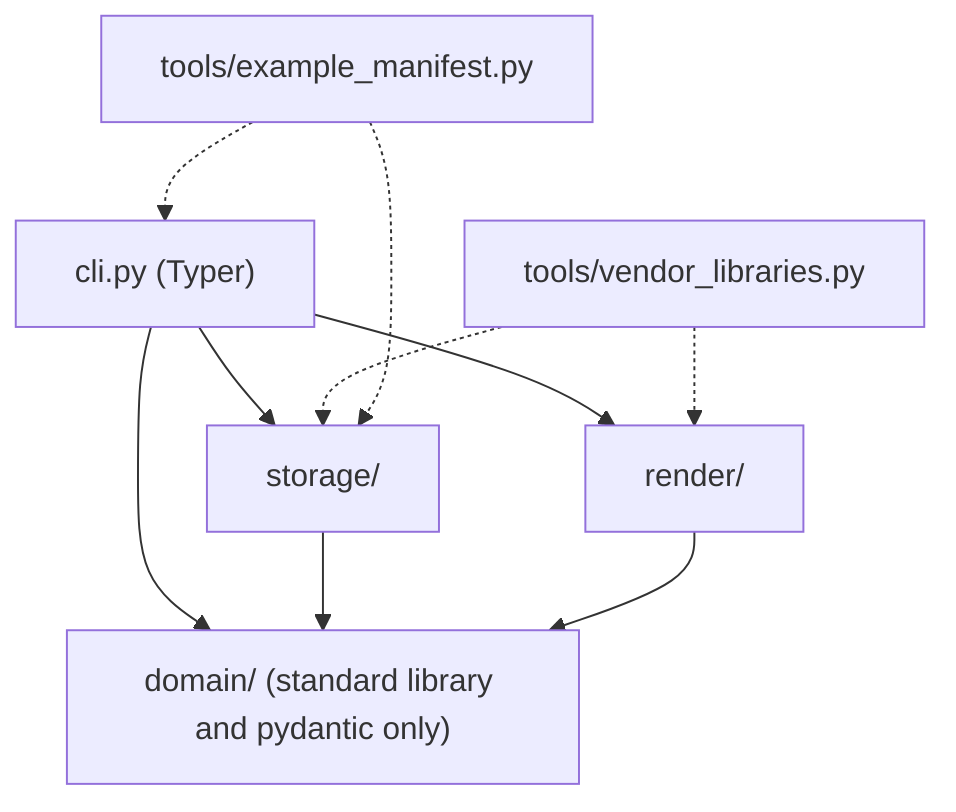

# Architecture

How the system is built. Why it is built that way: `docs/decisions.md`. Design notes of each change: `docs/architecture/`.

## Where facts live

Each fact has one home; other files link to it instead of copying it.

| Fact | Home | Other files link to it |
|---|---|---|
| Options, their defaults, relative-path rules | `--help` (`cli.py`), mirrored once in `docs/user-guide.md` § Options and checked by `tests/unit/test_cli.py` | `CLAUDE.md` Commands, this file |
| Streams, message form, exit codes | D-029 (contract); for users: streams in user guide § Options, message form and exit codes (the epilog's words) in user guide § Troubleshooting | this file § Overview, `how-it-works.md`, CHANGELOG |
| Domain resolution order | D-015 (rule); `docs/how-it-works.md` § How a table is classified (users) | user guide § Configuration, glossary, responsibility map |
| Config keys, presets, precedence | user guide § Configuration (keys checked by `tests/unit/test_docs.py`); D-030 (preset rules) | README § Configuration, this file § Configuration, `domain/CLAUDE.md` |
| Install, upgrade, uninstall | user guide § Install | README § Quick start |
| Run flow and the module of each step | modules: this file § Overview (diagram); for users: `how-it-works.md` § One run, step by step | README |
| What is read from the manifest, what the page contains, how views are laid out (concepts) | `docs/how-it-works.md` | this file § Overview, user guide |
| Layers and allowed imports | this file § Layers (diagram and table); enforced by `tests/unit/test_layering.py` | `CLAUDE.md` invariant 1, README |
| Developer commands, browser-test setup | `CLAUDE.md` § Commands | README § Development, agents, skills |
| CI content | D-053 (after D-020, D-031, D-043, D-044), `tools/ci.py` and `.github/workflows/ci.yml` | README |
| Vendored libraries, versions, licences | `render/page.LIBRARIES` and `src/dbtscope/render/vendor/README.md` | `how-it-works.md` § What the page contains, roadmap M2 |
| Page behaviour for users / for the designer | user guide (§ The universe view to § Exporting images) / `docs/ui-spec.md` (strings, colours, states) | — |
| Milestone status, open points | `docs/progress.md` | roadmap ("Done." marks only) |
| Universe grouping (domains or layers), its layout scopes and viewer memory | D-048 (contract); user guide § The universe view and § Configuration (users); `docs/ui-spec.md` § constellations by layer (design) | `render/CLAUDE.md`, `domain/CLAUDE.md` |
| Example project and its manifest | D-033, D-047, `tests/fixtures/acme_retail/notes.md`; for users: user guide § Try it on the example project | `examples/acme_retail/README.md` |
| Documentation screenshots and how to retake them | `docs/images/README.md` | user guide, README |
| The `/feature` workflow | `.claude/skills/feature/SKILL.md`; diagram in README § Working with Claude Code | D-007 |

## Overview

`dbtscope` is a command-line tool run from (or pointed at) a dbt project. It never connects to the warehouse: everything comes from the dbt manifest (D-012). One run:

Every failure ends in `cli.main`. Streams, message form and exit codes: D-029.

Data is typed with pydantic v2 at four layers (D-024, D-025): manifest input (`domain/manifest_schema`, only the fields read), domain model (`domain/model`: `Table`, `Column`, `Relation`, `LineageEdge`, `Group`, `Project`), configuration (`domain/config`: `Config`, `Rule`, `UniverseSettings`) and page payloads (`domain/payload`, the Python → JavaScript contract). Models are frozen; a malformed manifest or configuration stops the run with one line naming the field (`domain/errors.validation_message`). The page JSON is byte for byte what it was before the models (`tests/unit/test_reference_pages.py`).

The page does the layout itself, in the browser, on every filter change: layer bands packed into discs, d3-force for the constellations (domains, or layers, D-048), and a canvas for the universe (D-040), Graphviz (Viz.js) for the detail and for the flow view of a trajectory (D-014, D-036). Manual arrangements are kept in the browser and can be exported to `dbt-erd-layout.json`, which the next run embeds (D-013; one arrangement per grouping, D-048). The same concepts in user terms, without module names: `docs/how-it-works.md`.

Page tests: `tests/browser/` (D-019, D-022; commands in `CLAUDE.md`).

Design brief of the universe view, with the scoping decisions and the prototype results: `docs/brief-universe-view.md`.

## Layers

An arrow is an allowed import. `tests/unit/test_layering.py` enforces the rows of the table. `tools/` (dotted) is outside the package.

| Package | Role | May import (project packages) |
|---|---|---|
| `domain/` | Pure business logic: models (pydantic v2, D-025), rules, validation. No I/O, no clock, no environment (D-003). | nothing |
| `storage/` | File system and persistence: reads the manifest, config, presets and layout; the single atomic writer. | `domain` |
| `render/` | The HTML page: its assets (`assets/`) and `render_page`, which embeds the view data. | `domain` |
| `cli.py` | Command-line entry point, built with Typer (D-026): options and help, checks the paths given, runs `dbt parse` (its output on stderr), calls the layers, writes the page, opens the browser, prints the summary on stdout and maps every outcome to an exit code (D-004, D-029). The only module importing `typer`. | everything |

Data folders (not packages): `presets/` (built-in `*.yml` presets, read by `storage/project_files`), `render/assets/` (page shell, CSS, scripts), `render/vendor/` (vendored libraries and licences, refreshed by `tools/vendor_libraries.py`).

Add a row when adding a package, and the matching entry in `ALLOWED` of `tests/unit/test_layering.py`. Each package has a `CLAUDE.md` with its rules and module table.

## Responsibility map

One responsibility, one implementation (CLAUDE.md invariant 2). Check here before writing code; update this table when adding a cross-cutting responsibility.

| Responsibility | Implementation |
|---|---|
| Base class of business errors | `domain/errors.DomainError` |
| A list of choices in words (`a, b or c`) for messages and help | `domain/errors.in_words` |
| First letter of a quoted reason or problem in lower case | `domain/errors.lower_first` |
| One-line message of a validation error | `domain/errors.validation_message` |
| Match a table against selectors | `domain/selectors.matches`, `matches_any` |
| Value of a selector field on a table (also used by `group_of`) | `domain/selectors.field_value` |
| Case-insensitive wildcard match of a value (selectors, `tag:` and `group_by: tag:<glob>`) | `domain/selectors.glob` |
| Split a selector part into field and pattern (one parser for `matches` and `name_glob`) | `domain/selectors._split` |
| The name glob of a selector (its single name part, else none) | `domain/selectors.name_glob` |
| Extract tables, relations, lineage, groups from a manifest | `domain/manifest.parse_manifest` |
| Shape of the manifest fields dbtscope reads | `domain/manifest_schema` |
| Tables, columns, relations, lineage, groups, project | `domain/model` |
| Merge and validate the configuration | `domain/config.merge_config`, `Config` |
| Python → JavaScript page data contract | `domain/payload` |
| Read and parse the manifest file | `storage/project_files.read_manifest` |
| Read the layout file (missing → none) | `storage/project_files.read_layout` |
| Read `dbt-erd.yml` and presets (built-in by name, file by path) | `storage/project_files.load_config`, `read_preset`, `read_preset_file` |
| The built-in presets: their folder and names | `storage/project_files.PRESETS`, `preset_names` |
| Validate a preset on its own (closed keys, D-030) | `domain/config.check_preset`, `Preset` |
| Tell a preset name from a preset path | `domain/config.is_preset_path` |
| The config file a run reads (`--config`, else `dbt-erd.yml`), returned with the config and the preset applied | `storage/project_files.load_config` (`LoadedConfig`) |
| Read a project file as UTF-8 text, JSON or a YAML mapping, with one-line errors | `storage/project_files._read_text`, `_read_json`, `_read_yaml` |
| Decide whether a table is in a view's scope | `domain/classify.in_scope` |
| Group of a table (`group_by`) | `domain/classify.group_of` |
| First matching rule (kinds, domains, layers) | `domain/classify.first_rule` |
| Which columns are keys | `domain/classify.key_columns` |
| Light tint of a kind colour for a table body | `domain/classify.background` (`TINT`) |
| Domain key of a table (order: D-015) | `domain/universe.domain_of` |
| Role of a kind (validation, values) | `domain/config.KindRule`, `Role`, `ROLES`; preset form `PresetKindRule` |
| A file kind inherits the role of the preset kind it repeats | `domain/config._inherit_roles` (through `merge_config`) |
| Steps of the data flow, default layer of a table, its rank and step | `domain/steps.STEPS`, `FLOW_PREFIXES`, `UNRANKED`, `default_layer`, `flow_rank`, `step_of` |
| Star size and name priority by role; Types list order (page) | `render/assets/universe.js starR`, `ROLE_STAR`, `STAR_MAX`, `ROLE_ORDER`, `NAME_ORDER`, `OVERVIEW_K`, `orderLabels` |
| Main core tables of a constellation, by relations (page; names now, cards in M8.3) | `render/assets/universe.js mainTables` |
| Parent of a descriptive table (relation, then name stem; same domain; ties none) and the stem of a table (M8.2, D-061) | `domain/fold.parents`, `stem` |
| Which tables are drawn, folded or shown; entity marks and counts (page, D-062) | `render/assets/universe.js PARENT`, `FOLDED`, `layout`, `placeShown` |
| The viewer's last fold choice, kept out of the layout (page) | `render/assets/universe.js foldMemory` |
| The large generated Data Vault project (tests) | `tests/large_project.large_manifest`, `write_large_project`, `LARGE_CONFIG`; browser fixture `tests/browser/conftest.large_page` |
| Validate an exported layout (format, version, sections) | `domain/layout.check_layout`; `LAYOUT_FORMAT`, `LAYOUT_VERSION`, `LAYOUT_SECTIONS`; `LAYOUT_HINT` (what to do with a bad layout file) |
| Assemble the HTML page | `render/page.render_page` |
| Serialise a payload for the page (one encoder, D-023 escape) | `render/page.embedded_json` |
| JavaScript libraries of the page (CDN URL, vendored file, licence, hash); markup a vendored file may not hold | `render/page.LIBRARIES`, `UNSAFE_MARKUP` |
| Every vendored file and where it comes from (URL, label, SPDX id, script sha256) | `render/page.vendored_files`, `VendoredFile` |
| Script tags or inline libraries of the page | `render/page._scripts` |
| Where the page's assets and vendored libraries are read from (package resources) | `render/page.ASSETS`, `VENDOR` (also used by `tools/vendor_libraries.py`) |
| Refresh the vendored libraries | `tools/vendor_libraries.py` |
| Regenerate the example manifest (`dbt parse` through `cli.main`, D-033) | `tools/example_manifest.parse`, `main` |
| Escape untrusted text for `innerHTML` (page) | `render/assets/common.js esc` |
| A count with plural agreement (page) | `render/assets/common.js plural` |
| A number written for the page language (page) | `render/assets/common.js num` |
| Label–value separator of the page language (page) | `render/assets/common.js L.colon` |
| Contrast of text with a colour; the text colour on a fill; a colour made readable as text; a colour made to mark against the page, 3:1 (page) | `render/assets/common.js CONTRAST` (`ratio`, `textOn`, `ink`, `AA`, `edge`, `MARK`; one darkening for `ink` and `edge`, D-042) |
| A colour dot of the page, outlined when its colour is too light (page) | `render/assets/common.js paintDot` |
| The outline of a Graphviz cell filled with a config colour (page) | `render/assets/common.js dotEdge` |
| Theme colours used by the scripts (copy of `page.css :root`) | `render/assets/common.js THEME` |
| Side panel toggle and opening state (page) | `render/assets/common.js sidePanel` |
| A filter checkbox row (page) | `render/assets/common.js filterRow` |
| Page strings shared by several scripts | `render/assets/common.js STRINGS` / `L` |
| A select's options from [value, label] pairs (page) | `render/assets/common.js fillSelect` |
| Name and meta lines of a table tooltip (page) | `render/assets/common.js tableTip` |
| A table's description line in a tooltip (page) | `render/assets/common.js tableDesc` |
| Lineage traversal from one table (page) | `render/assets/common.js trajectory` |
| The lineage edges of a trajectory (page) | `render/assets/common.js trajectoryEdges` |
| Colours of upstream / downstream (page) | `render/assets/common.js TRAJ_COLORS` |
| Counts, empty text, levels and tooltip lines of a trajectory (page) | `render/assets/common.js trajectoryCounts`, `noTrajectory`, `trajectoryLevels`, `trajectoryTip` |
| Tables per domain (page) | `render/assets/common.js countByDomain` |
| Escape a DOT string (page) | `render/assets/common.js dotStr` |
| Escape text inside a Graphviz HTML-like label (page) | `render/assets/common.js dotText` |
| Render DOT with Graphviz, recovering from a failed render (page) | `render/assets/common.js GRAPHVIZ` |
| Mount, fit and unmount a Graphviz SVG with pan and zoom (page) | `render/assets/common.js graphZoom`, which resolves the handle `zv` built by `zoomHandle(box, layer, size, onZoom)` (`layer`, `fit`, `get`, `set`, `centre`, `destroy`) |
| Attach a d3 zoom to a view's drawing area, Safari trackpad pinch (`gesture*` events) included (page, all three views) | `render/assets/common.js zoomOn` |
| Scale range of every zoom of the page | `render/assets/common.js ZOOM_EXTENT` |
| Columns along the data flow: lineage, layers as a floor, tables without a layer by lineage (page) | `render/assets/common.js flowRanks` |
| Flow view (page) | `render/assets/flow.js startFlow` |
| The flow's start ring (constant screen size, resized on zoom) and **locate start** (header button `#f-start`) (page) | `render/assets/flow.js addRing`, `ringStart`, `locateStart` |
| Bring filtered-out tables back (page) | `render/assets/universe.js reveal` |
| Display name of a payload domain, layer or kind (`label ?? key`) (page) | `render/assets/common.js labelOf` |
| What a universe constellation stands for, domain or layer: key, band, rank, pins, layout scope (page, D-048) | `render/assets/universe.js BY`, `grouping` |
| The viewer's last grouping, kept out of the layout (page, D-048) | `render/assets/universe.js byMemory` |
| Placement of a constellation's tables: bands (layer bands, or domain bands in layer mode) in one row, in the smallest circle (page) | `render/assets/universe.js layoutConstellation`, `bandsOf`, `columns`, `packRow` |
| A band's span on its disc and the disc's upper rim (page, layer mode) | `render/assets/universe.js bandSpans`, `rimAngle`, `rimHalf` |
| Domain bands of a layer constellation: tint, rim arcs, band names; its tooltip (page) | `render/assets/universe.js drawDomainBands` (`TINT`, `TINTS`), `drawBandNames`, `layerTip` (`TIP_DOMAINS`) |
| A table name on one or two lines (universe, page) | `render/assets/universe.js nameLines` |
| The constellation radius that holds a box (page) | `render/assets/universe.js holds`, `margin` (used by `layoutConstellation` and `reach`) |
| Rectangular de-overlap around dragged tables (page) | `render/assets/universe.js separate` (pinned), `placeAroundDragged` |
| Save a file from the page (Blob download) | `render/assets/boot.js saveFile` |
| Name, scale and save an exported image (page) | `render/assets/boot.js EXPORT` |
| Draw the universe (screen or image) | `render/assets/universe.js draw(target, scale)` |
| Visible Graphviz diagram (detail, flow) as a standalone SVG / PNG (zoom layer transform removed) | `render/assets/common.js svgImage`, `svgFile`, `pngImage`; `INLINE` |
| Write a file atomically (temp + fsync + rename) | `storage/files.atomic_write` |
| Words of an `OSError` (`permission denied`), the same on every OS | `storage/files.os_reason` (`REASONS`) |
| Whether the system refused a path for a too-long name (POSIX or Windows forms) | `storage/files.is_name_too_long` (`MAX_NAME`) |
| Command-line options and help | `cli.app`, `cli.command`, `Options` |
| What a user-given path is (missing, folder, file, other; one `stat`) and what to do when the system refuses it | `storage/files.path_kind` (`PathKind`), `refused_hint` |
| Resolve and check the paths given on the command line | `cli._resolve` (project, config, manifest, and `--dbt` only when given), `cli._output` (the page), each through `cli._kind` (`path_kind`, refused path named by its option); `--preset-file` is resolved by `cli._resolve` and checked by `storage/project_files.read_preset_file` (as the `preset:` key) |
| How messages name a config file (`config <path>`) | `storage/project_files.config_source` |
| How messages name the config of a run (its file, the preset applied, or the defaults) | `cli._config_label` (through `config_source` for a file) |
| One run: config, `dbt parse`, manifest, views, layout, page, summary | `cli.run` |
| Run `dbt --log-level <level> parse` (level from `--log-level`, default `error`, D-057; output on stderr, OS errors and exit code as `ParseError`) | `cli._dbt_parse` |
| Run dbt parse, or fall back to the earlier manifest (warning), or stop (no manifest, `--strict-parse`; D-054; at log level `none` the failure says it hid dbt's messages, D-057) | `cli._parse` (`Fallback`, `ParseError`, `_has_manifest`, `_modified`) |
| The manifest exists after `dbt parse` or with `--no-parse` | `cli._check_manifest` (through `_has_manifest`, the one "usable manifest file" check) |
| Age of a file in words, and the UTC moment of the CLI | `cli._age`, `cli._moment` (used by `_saved` and the fallback warning) |
| Build both views (a selector error names the config); empty views as an error or warnings | `cli._views`, `cli._check_views` |
| Write the page, OS errors named by the output | `cli._write_page` |
| Open the page in the browser (a failure is a warning) | `cli._open_browser` |
| Write one line of the CLI on stdout or stderr | `cli._say` (`_warn`; `_fail`, the one place that collapses whitespace) |
| The success summary | `cli._summary` (`Report`; counts `_count`, sizes `_size`, layout date `_saved`; the `manifest:` row of a fallback; the `fold:` row, `_fold_row`, M8.2) |
| Map an error to a CLI exit code and message (0, 1, 2 usage, 130 interrupted) | `cli.main` (`_usage_message`, `_fail`) |
| Check a commit message | `tools/check_commit_message.problems` |
| The CI checks, locally and in the manual workflow (D-053) | `tools/ci.STEPS`, `tools/ci.main` |
| Block secrets, protected folders, commits and pushes on `main` (Claude Code); the project's list in `.claude/guard.json` | `.claude/hooks/guard_paths.py` |
| Check package module tables and this map against the code (D-052) | `tools/doc_consistency.problems` |
| Fail while `TODO(project):` markers are left in a project (D-050) | `tests/unit/test_template_markers.py` |
| Format and lint-fix an edited file (Claude Code) | `.claude/hooks/format.py` |
| Build the `shop` test manifest and its parts (tests) | `tests/conftest.shop_manifest`, `model`, `source`, `relationships_test`; `SHOP` (id prefix) |
| Empty payloads and a single `Table` (tests) | `tests/conftest.empty_detail`, `empty_universe`, `table` |
| Write a test project and its files (tests) | `tests/conftest.write_project`, `write_manifest`, `write_config`, `write_layout`; fixtures `dbt_project`, `shop` |
| Copy the example project with its committed manifest (tests) | `tests/conftest.write_example`, `EXAMPLE`, `EXAMPLE_MANIFEST`, `EXAMPLE_EXPECTED`, `EXAMPLE_TOOL`; fixture `example_project`. The example's paths and `LOCAL` ignore list are owned by `tools/example_manifest` (the committed manifest's path is its `TARGET`); `tests/conftest` reuses them |
| A fake dbt executable (tests) | `tests/conftest.fake_dbt_executable` |
| Write a preset file (tests) | `tests/conftest.write_preset`, `PRESET_TEXT` |
| Split a Markdown doc into fenced blocks and prose (tests) | `tests/conftest.Block`, `blocks`, `prose`; `USER_GUIDE` (path of the user guide) |
| Build a project's page from its manifest and read its payload (tests) | `tests/conftest.page_of` |
| Read the embedded data block of a page (tests) | `tests/conftest.data_block` (bytes), `page_data` (dict); `DATA_OPEN` (its opening tag) |
| Import a script by path (`tools/`, `.claude/hooks/`) (tests) | `tests/conftest.load_script` |
| CLI arguments that build from the written manifest (tests) | `tests/conftest.NO_PARSE_NO_OPEN` |
| Build and open the page in Chromium (browser tests) | `tests/browser/conftest.build_page`, `open_page`, `shop_page` (`Shop`), `example_page`, `Page`; session fixtures `browser` (the local Chromium) and `cdn` (the vendored libraries served for their CDN URLs); `VIEWPORT` (the default window) |
| Block every request but the page's own (browser tests) | `tests/browser/conftest.only_own_url` |
| Drive and measure the page (browser tests) | `tests/browser/conftest.show_detail`, `wait_exportable`, `open_flow`, `wait_flow`, `close_panel`, `scroll_width`, `names`, `names_of`; `NARROW`, `PAGE_BG`, `CENTRE_WAIT_MS` |
| The page of a synthetic universe payload (browser tests) | `tests/browser/conftest.universe_page` |

## Glossary

One word per concept (D-027). Code, tests and docs use these words; names protected by invariant 9 and the CLI options keep their spelling even where the glossary prefers another word.

| Concept | Word | Not | Notes |
|---|---|---|---|
| A model, seed, snapshot or source of the manifest | **table** (`Table`, `tables`) | node, entity, model (except dbt's resource type `model`) | Identified by its `unique_id` (invariant 11). |
| A table as an item of the universe payload | **node** only as the payload key `nodes` and `UniverseNode` | — | Protected key; Python variables holding `UniverseNode`s are `nodes`. "Node" also stays for dbt's manifest `nodes` and `NodeHeader`. |
| A table as an item of the detail payload | **entity** only as the payload key `entities` and `DetailEntity` | — | Protected key; variables holding `DetailEntity`s are `entities`. |
| Business link declared by a `relationships` test or a `foreign_key` constraint | **relation** (`Relation`, `relations`) | relationship (except dbt's test name), FK link | |
| `ref` / `source` dependency | **lineage** (`LineageEdge`, `lineage`); one item is a **lineage edge** | dependency, parent link | |
| What the page draws for a relation or a lineage edge | **link** | edge (in UI text) | User-facing only: config `universe.links`, the page, the CLI summary ("lineage links"). In code, "edge" only for a lineage edge or a drawn graph edge. |
| Classification of a table by the `kinds` rules (hub, fact…) or its built-in fallback | **kind** (`kinds`, `BuiltinKind`, `TYPE_KINDS`) | type, category | The page labels kinds "Types": UI text, frozen with the page. |
| dbt's `model` / `seed` / `snapshot` / `source` | **resource type** (`resource_type`, selector `type:`) | kind | |
| Data domain of the universe (resolution: D-015) | **domain** | — | Its disc is a constellation in domain mode. |
| The disc of the universe that groups tables: one domain (domain mode) or one layer (layer mode) (M5.13, D-048) | **constellation** (config `universe.constellations`, payload `defaults.constellations`, `BY`, `layoutConstellation`) | domain (for a layer's disc), group, cluster | "Group" is the `group_by` value and the dbt group. The grouping is **domain mode** / **layer mode**. |
| Position along the data flow | **layer** | stage, level | "level" is the trajectory depth. |
| How much a kind matters in the structure (M8.1, D-058) | **role** (`role`, `Role`, `ROLES`, `KindRule.role`): `core`, `connector`, `descriptive`, `technical`, or none | importance, weight, tier, type | French UI wording: « rôle » ; `core` « centrale », `connector` « de liaison », `descriptive` « descriptive », `technical` « technique » (adjectives of « table »). In the trajectory, start / upstream / downstream is a **side**, never a role. |
| Place of a default layer along the data flow, from its folder-name prefix (D-059) | **step** (`domain/steps.STEPS`, selector `step:`) | stage, level, rank (rank is its number) | `source`, `staging`, `reference`, `intermediate`, `product`, `report`. |
| A table's place in a trajectory: start, upstream, downstream | **side** (`universe.js sideOf`) | role | Renamed from `roleOf` in M8.1. |
| The `core` or `connector` table a `descriptive` table is folded into (D-061) | **parent** (`UniverseNode.parent`, `domain/fold.parents`, `PARENT`) | owner, hub, anchor | In prose "parent table"; never for lineage ("parent" of a `LineageEdge` / `Relation` stays the model's field name). |
| Drawing a descriptive table inside its parent instead of as its own star (D-062) | **fold** (config `universe.fold`, payload `defaults.fold`, `state.fold`, `foldMemory`); a **folded table**; the opposite is **shown** | collapse, merge, hide | French UI: « replier » / « afficher » ; « table repliée ». |
| A core or connector table with the tables folded into it (UI, D-062) | **entity** in UI text only (`T.entitiesN`) | holder, group, cluster | French « entité ». In code the table is the **parent** and its tables `FOLDED`; the payload words `entities` / `DetailEntity` (D-027) stay the detail's tables, a different concept, written "detail entity" in prose. |
| A descriptive table's name without its kind's fixed glob part (D-061) | **stem** (`domain/fold.stem`) | root, base name | Compared at a non-alphanumeric boundary. |
| The strip of a domain constellation where the tables of one layer are placed (universe, M5.5, D-040) | **layer band** | column, lane | "Column" is the flow's word. |
| The strip of a layer constellation where the tables of one domain are placed (universe, M5.13, D-048) | **domain band** | column, lane | Code says **band** for both kinds. |
| The left-to-right Graphviz diagram of one trajectory (M5.3, D-036) | **flow** (the flow view, `flow.js`) | lineage view, lineage graph | Its columns are computed by `flowRanks`; "level" stays the trajectory depth. |
| `group_by` value of a table in the detail view | **group** | — | dbt's own group is **dbt group** in prose; the field stays `Table.group`. |
| The Python → JavaScript contract and its models | **payload** (`PagePayload`, `DetailPayload`, `UniversePayload`) | data (for the contract) | **data** is for untyped values, bytes and the page's `#data` block. |
| Configuration | **config** (`Config`, `dbt-erd.yml`) | settings (except `UniverseSettings`, the `universe` section) | |
| Licence text and files of the vendored libraries | **licence** (noun, as in `Library.licence`) | license | "license" only in external names: SPDX ids, `pyproject` `license`, upstream `LICENSE*` file names. |
| The manual arrangement | **layout** (`dbt-erd-layout.json`, `LAYOUT_FORMAT`) | arrangement (UI prose only) | |

## Configuration

Keys, presets and precedence: `docs/user-guide.md` § Configuration; preset rules: D-030; layout file: D-013. The tool needs no secret.

Convention of this repository: secrets in `.env` (git-ignored, template in `.env.example`), machine-specific settings in `config.toml` (git-ignored), local runtime data in `.local/` (git-ignored; `.local/dev-data/` for development, `.local/credentials/` never read by Claude Code).
