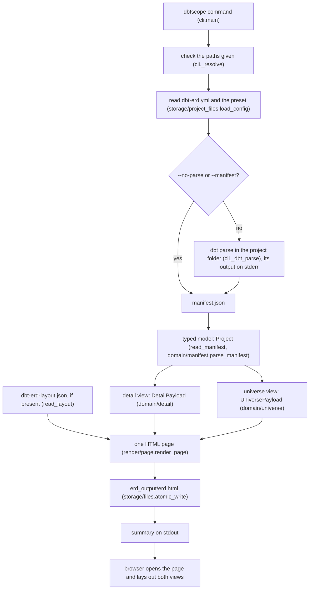
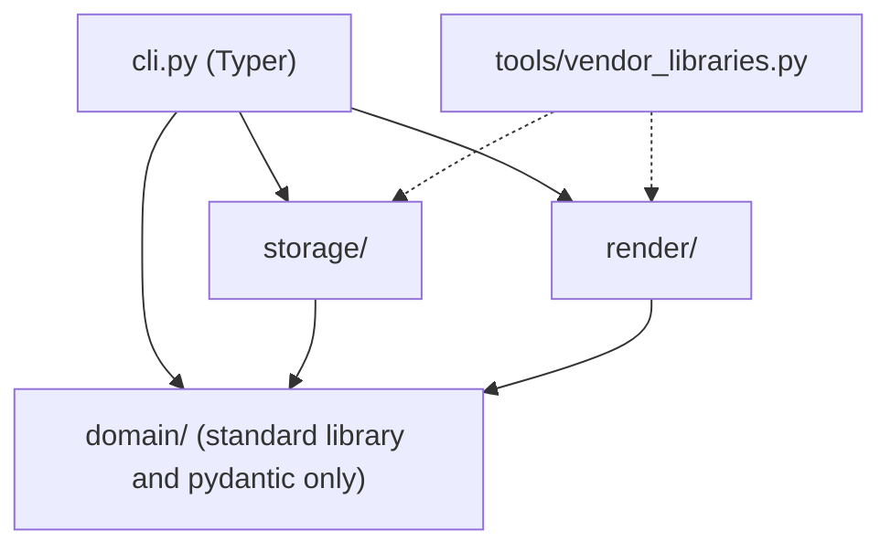
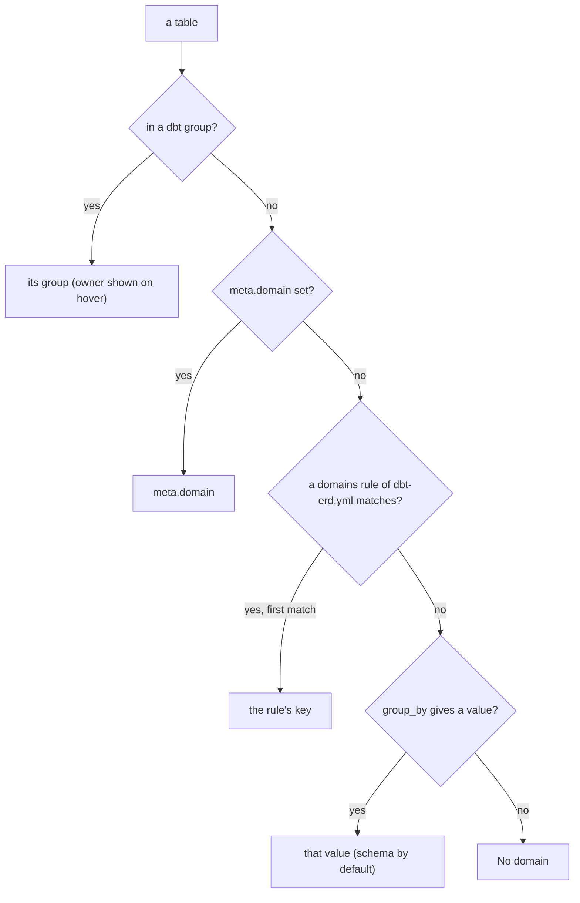
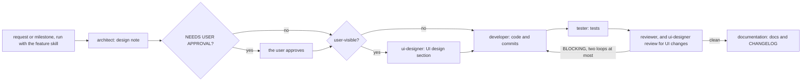

# M4.3 — Documentation: one home per fact, use cases first, Mermaid diagrams (design note)

Status: DONE (built and reviewed on 2026-11-04). The brief (`docs/briefs/2026-11-04-m4-review-cli-docs.md` § M4.3) and the roadmap (M4.3) describe this work. No decision is superseded, no data format changes, no code changes outside one test. The install commands of § 2 are the standard uv commands; the caller reports that the user confirmed these are the ones they use (2026-11-04).

## Context

Request: make every doc coherent (same words, commands, option names and decision numbers), give each fact one home, open the README with copy-paste use cases, add Mermaid diagrams where they explain a process, and add a cheap test that fails when the README option table drifts from `--help`.

State verified in the code before writing:
- Options (`src/dbtscope/cli.py:136-240`): `--version`, `-h/--help`, Project panel `--project-dir`, `--config`, `--preset`, `--preset-file`; dbt panel `--no-parse`, `--manifest`, `--dbt`; Output panel `-o/--output`, `--no-open`; Page panel `--view`, `--offline`. `--preset` with `--preset-file` is exit 2 (`cli.py:236-237`).
- `dbt_project.yml` is required in every mode, `--no-parse` and `--manifest` included, and is only checked for existence, never read (`cli._project`, `cli.py:263-269`). `dbt_project.yaml` gets its own hint ("dbt reads dbt_project.yml only, rename dbt_project.yaml").
- Domain resolution order (`domain/universe.domain_of`, `universe.py:44-53`): dbt group, then `meta.domain`, then the first matching `domains` rule, then `group_of(table, group_by)` (default `group_by: schema`, `config.py:146`); an empty result is "No domain" / "Hors domaine" (`universe.py:27`).
- Streams, message form and exit codes: D-029 (0, 1, 2, 130). The epilog of `--help` ends "Exit codes: 0 done, 1 error, 2 wrong option, 130 interrupted." (`cli.py:64`).
- `dbt parse` needs no connection, but it needs the project's profile (`profiles.yml` in the project folder or `~/.dbt`) and the adapter installed: a missing profile fails with dbt's own error, then `dbt parse failed with exit code 2` (M4.2 sandbox, findings #11, #12).

Docs that stay historical and are not rewritten: `docs/brief-universe-view.md`, `docs/briefs/*`. Design notes are point-in-time records: only their `Status:` line is updated to point at what superseded them (§ 1.8), never their body.

## Chosen design

The developer (documentation work only) follows §§ 1–4 in the commit order of § 6. Nothing under `src/` changes. `render/assets/*` must not change (D-028).

### 1. Coherence audit

Each item gives the file and line, the fix, and the home of the fact. "Link" means: replace the copy with one sentence and a link to the home.

#### 1.1 Home of each fact

This table goes into `docs/architecture.md` as a new short section "Where facts live", right after the opening paragraph. The documentation agent reads it (§ 1.7).

| Fact | Home | Other files link to it |
|---|---|---|
| Options, their defaults, relative-path rules | `--help` (`cli.py`), mirrored once in README § Options and checked by a test (§ 4) | `CLAUDE.md` Commands, `docs/architecture.md` |
| Streams, message form, exit codes | D-029 (contract); README § Troubleshooting (users, one sentence, the epilog's words) | `docs/architecture.md` Overview, CHANGELOG |
| Domain resolution order | D-015 (rule); README § Universe (users, with the diagram of § 3.3) | glossary, responsibility map |
| Config keys, presets, precedence | README § Configuration; D-030 (preset rules) | `docs/architecture.md` § Configuration, `domain/CLAUDE.md` |
| Run flow and the module of each step | `docs/architecture.md` § Overview (diagram § 3.1) | README § Development |
| Layers and allowed imports | `docs/architecture.md` § Layers (diagram § 3.2 + table); enforced by `tests/unit/test_layering.py` | `CLAUDE.md` invariant 1, README |
| Developer commands, browser-test setup | `CLAUDE.md` § Commands | README § Development, agents, skills |
| CI content | D-020 and `.github/workflows/ci.yml` | README |
| Vendored libraries, versions, licences | `render/page.LIBRARIES` and `src/dbtscope/render/vendor/README.md` | README § Offline page, roadmap M2 |
| Page behaviour for users / for the designer | README § The page / `docs/ui-spec.md` (strings, colours, states) | — |
| Milestone status, open points | `docs/progress.md` | roadmap ("Done." marks only) |
| The `/feature` workflow | `.claude/skills/feature/SKILL.md`; diagram in README § Working with Claude Code (§ 3.4) | D-007 |

#### 1.2 `README.md`

The README is restructured by § 2. The facts below must be fixed whatever the new place of the text.

| Line | Problem | Fix |
|---|---|---|
| 5 | "becomes an edge" (glossary D-027: a relation, drawn as a link) | "becomes a relation, drawn as a link" |
| 7-15 | "Usage" is a single `uvx` command; install, live, CI and no-dbt cases are missing | replaced by § 2 Install and Use cases |
| 17 | relative-path rules: fine, mirror of the epilog | keep in README § Options only |
| 36 | `--version`, `-h, --help` row has no text | "show the version / this help and exit", under a group row **Other** (§ 4) |
| 38 | streams and exit codes: second copy of D-029 | keep one sentence, using the epilog's exact words (checked by § 4), in § Troubleshooting |
| 40 | runtime needs and the pydantic v1 advice: belongs to install | move into § Install as one sentence (uv tool installs are isolated, which solves the pydantic v1 case) |
| 53 | "tick **layers**, **types** and **domains**" | "**Types** (the kinds)": the label is the page's, the concept is kind (D-027) |
| 67 | domain order as a sentence | sentence + diagram § 3.3 |
| 74 | "cross-group edges" | "cross-group links" |
| 94, 98 | CDN dependency stated twice; the full licence list copied from `render/vendor/README.md` | merge into § Offline page; licences: one sentence and a link to `src/dbtscope/render/vendor/README.md` |
| 136 | `hidden_kinds: []  # types unticked at opening` | `# kinds unticked at opening (the page's Types boxes)` |
| 139 | `dbtscope: error: manifest: <location>: <problem>` (pre-D-029 form); config example lacks the file | `dbtscope: error: manifest <path>: <location>: <problem>`; `dbtscope: error: config <path>: view: must be 'universe' or 'detail'; fix the file` |
| 102, 157 | precedence stated twice | once, in the Configuration intro; Preset files says "same precedence" |
| 196-207 | "A table shows up without links?" is a top-level section | first entry of § Troubleshooting |
| 211-228 | troubleshooting misses many messages of the code | complete table, § 2.6 |
| 235 | `uv run pytest -q -n auto` (differs from `CLAUDE.md`) | link to `CLAUDE.md` § Commands, keep a three-line quick start in the same words |
| 247 | `playwright install chromium` without context | "once, by hand (the tooling never runs it, D-019)" |
| 249-259 | code layout table copies `docs/architecture.md` Layers and package `CLAUDE.md` files; its `docs/` row omits `ui-spec.md`, `architecture/`, `briefs/` | replaced by one sentence linking `docs/architecture.md` (diagrams § 3.1, § 3.2) |
| 265 | CI described again | link D-020; add diagram § 3.4 |
| 267 | heading "License" (glossary: licence, except external names) | "Licence"; the file name `LICENSE` stays |

#### 1.3 `CLAUDE.md`

| Line | Problem | Fix |
|---|---|---|
| 11 | "constraints become edges" | "become relations" |
| 15 | "Read next" omits `docs/ui-spec.md`, `docs/architecture/` (design notes) and `docs/briefs/` | add them, with one word each, as the other entries |
| 49 | invariant 11 "A node is identified…" (glossary: table) | "A table is identified by its dbt `unique_id`…". Same rule, glossary word only: not a new decision |

The Commands section stays the home of developer commands. No other change.

#### 1.4 `docs/architecture.md`

| Line | Problem | Fix |
|---|---|---|
| 3 | — | add § "Where facts live" (§ 1.1) after this paragraph |
| 9-21 | text block of the run: replaced by the run-flow diagram, which keeps the module names | diagram § 3.1 |
| 23 | full copy of D-029 | "Streams, message form and exit codes: D-029." |
| 29 | browser tests: copy of `CLAUDE.md` Commands, D-019, D-022 | one line: "Page tests: `tests/browser/` (D-019, D-022; commands in `CLAUDE.md`)." |
| 33-44 | Layers table only | diagram § 3.2 above the table |
| 72 | responsibility map row repeats the domain order | "Domain key of a table (order: D-015)" |
| 124 | glossary row repeats the domain order | "Data domain of the universe (resolution: D-015)" |
| 134 | Configuration paragraph copies README and D-030 | "Keys, presets and precedence: README § Configuration; preset rules: D-030; layout file: D-013." Keep the repository convention paragraph (line 136) |

#### 1.5 `docs/decisions.md`

Partial supersessions are marked on the old entry, as D-004, D-015, D-017, D-024, D-025 and D-028 already are. Four entries lack their marker:

| Line | Entry | Marker to add after the title |
|---|---|---|
| 10 | D-002 | (CI part superseded by D-020.) |
| 41 | D-011 | (Page strings: "from locale files" superseded by D-016.) |
| 52 | D-014 | (Opt-in offline page: D-021; JSON escaping: D-023.) |
| 67 | D-019 | (Network part superseded by D-022.) |

`.claude/skills/add-decision/SKILL.md:9` asks for `**Superseded by D-NNN**`. The file uses another form. Align the skill with the file: "add `(Superseded by D-NNN.)`, `(<clause> superseded by D-NNN.)` or `(Refined by D-NNN.)` after the old title".

No decision number is wrong anywhere. Every `D-0xx` cited in the docs exists (D-001 to D-030).

#### 1.6 `docs/roadmap.md`, `docs/progress.md`, `CHANGELOG.md`

| File:line | Problem | Fix |
|---|---|---|
| roadmap:3 | "on the branch `dev`": `CLAUDE.md` says a feature branch or `dev`, and M4 runs on a feature branch | "on a feature branch or `dev` (CLAUDE.md, Git workflow)" |
| roadmap:9 | `/init-project`: the skill no longer exists | append "(done at bootstrap; the skill has since been removed)" |
| roadmap:49 | M1 browser test "needs the CDN scripts" | append "(since M2 no network, D-022)" |
| roadmap:106 | M3 error `manifest: <location>` | append "(form since M4.2: `manifest <path>: …`, D-029)" |
| roadmap:138 | M4.3 | add "(Done.)" in the final docs commit |
| progress:3 | "Branch: `dev`" | "Branch: a feature branch per session, or `dev` (CLAUDE.md)" |
| progress:7 | B0 "in progress" | unchanged: only the user can confirm the hooks and CI (stop condition of `/build-roadmap`). Mention it in the end-of-phase report |
| progress:15 | M4.3 row | done, with a three-line summary |
| CHANGELOG:20, 25 | all of this is `[Unreleased]`, so the M3 form `manifest: <location>` was never released, yet line 20 says it is "replaced" | line 25: final form `manifest <path>: <location>: <problem>`; line 20: drop "(`manifest <path>: …` replaces `manifest: …`)" |
| CHANGELOG:26 | `view: must be …` without the file | `config <path>: view: must be 'universe' or 'detail'; fix the file` |
| CHANGELOG:34 | the one-line error and atomic writes repeat line 20 | merge into line 20, keep "the page is written atomically" |
| CHANGELOG:48-49 | template history (`/init-project`, CI on three OS) | keep: the "Template" section is history and is accurate for its time |
| CHANGELOG | M4.3 entry missing | add under Changed: "README opens with install and use cases; diagrams of the run, layers, domain resolution and workflow; troubleshooting covers every error; a test keeps the README options in line with `--help` (M4.3)." |

#### 1.7 Claude Code files (command and option drift, template leftovers)

| File:line | Problem | Fix |
|---|---|---|
| `.claude/agents/ui-designer.md:4` | "Delete this agent if the project has no UI." (template) | remove the sentence |
| `.claude/agents/ui-designer.md:15` | "small ES modules" (the page inlines plain scripts, D-014) | "plain scripts inlined in the page (D-014)" |
| `.claude/agents/ui-designer.md:18` | "from locale files" (contradicts D-016) | "from the `L` / `T` string tables of the scripts (D-016)" |
| `.claude/agents/tester.md:11` | "API test client…", "fakes replaying recorded data from tests/fixtures/" (template) | "the CLI `main([...])` and the entry points (`python -m dbtscope`, the `dbtscope` script); fake `dbt` scripts written into `tmp_path`" |
| `.claude/agents/developer.md:14`, `reviewer.md:13`, `skills/release/SKILL.md:8` | three different subsets of the checks: `ruff format --check` is missing in the developer and reviewer lists | "run the checks of the definition of done (`CLAUDE.md`, commands in § Commands)", keeping the pytest line for speed. Do not edit `tester.md:16`: its `--cov` run is specific to the tester |
| `.claude/agents/documentation.md:12` | "do not duplicate, link instead" exists but has no map | append "(homes: `docs/architecture.md` § Where facts live)" |
| `.claude/skills/feature/SKILL.md:3` | example "add a --json option to the list command" (dbtscope has no `list` command) | "e.g. \"/feature M1\" or \"/feature fix the French label of Fit\"" |
| `.claude/skills/add-decision/SKILL.md:9` | marker form, § 1.5 | as § 1.5 |
| `.claude/skills/add-fixture/SKILL.md:10-11` and `tests/fixtures/README.md:6-7` | `expected.json` / `response.json` (template). The only fixture (`m3-reference-pages/`) uses hashes and data blocks; dbtscope has no remote service (invariant 7) | "the expected result in the form its test reads (`expected.json` by default)"; drop `response.json` and rule 5 of the skill |

`skills/build-roadmap` works on `dev` by design (autonomous mode): consistent with `CLAUDE.md`, no change. No agent or skill cites an option name.

#### 1.8 Design notes (`Status:` line only)

| File:line | Fix |
|---|---|
| `2026-11-03-m1-trajectory-mode.md:3` | prefix "DONE (2026-11-03). The CDN download of the browser tests (lines 198, 205, 297) is superseded by D-022." |
| `2026-11-03-m2-export-offline.md:3` | prefix "DONE (2026-11-03)." |
| `2026-11-04-m3-typed-model.md:3` | prefix "DONE (2026-11-04). Since M4.2: the CLI is Typer (line 135, D-026); manifest errors read `manifest <path>: …` (lines 195, 301, D-029)." |
| `2026-11-04-m4.2-cli-typer.md:5-10` | add to "Final state": "`--preset-file` added in M4.2b (D-030): the help of the UI design section lacks it." |

### 2. README outline

The order follows the brief. Every command is in a fenced block with a language (`powershell`, `bash`, `yaml`), so that it copies cleanly and the test of § 4 can find it. Headings:

```
# dbtscope                      pitch: lines 3-5, glossary fixed (§ 1.2)
## Install
### Windows (PowerShell)
### macOS
### Linux
### Run once without installing
### Upgrade
## Use cases
### Live analysis
### Batch and CI
### A project in another folder
### Without dbt installed
## Options                       the checked table (§ 4)
## The page                      Universe (+ domain diagram), Trajectory, Detail, Export image, Manual arrangement, Offline page
## Configuration                 keys, precedence, Preset files, Examples
## Selectors
## Troubleshooting               missing links first, then the error table
## Development                   quick start, link to CLAUDE.md, Working with Claude Code (+ /feature diagram)
## Licence
```

#### 2.1 Install

Windows (PowerShell), either line installs uv:

```powershell
winget install --id=astral-sh.uv -e
# or
powershell -ExecutionPolicy ByPass -c "irm https://astral.sh/uv/install.ps1 | iex"
```

macOS:

```bash
brew install uv
# or
curl -LsSf https://astral.sh/uv/install.sh | sh
```

Linux:

```bash
curl -LsSf https://astral.sh/uv/install.sh | sh
```

Then, on every system:

```bash
uv tool install git+https://github.com/christophebnx/dbtscope
uv tool update-shell        # puts dbtscope on PATH; open a new terminal afterwards
dbtscope --version
```

- Run once without installing: `uvx --from git+https://github.com/christophebnx/dbtscope dbtscope --preset data_vault`.
- Upgrade: `uv tool upgrade dbtscope` (it fetches the latest commit of the repository).
- Requirements, in one sentence: uv provides Python ≥ 3.12 and the dependencies (PyYAML, pydantic v2, Typer) in an isolated environment, so a project pinned to pydantic v1 is not affected. `dbt` is only needed to run `dbt parse`: it must be on `PATH` (or given with `--dbt`), with the project's adapter and profile installed. No connection is made.

#### 2.2 Live analysis

```bash
cd path/to/your/dbt/project      # the folder that holds dbt_project.yml
dbtscope --preset data_vault
```

This runs `dbt parse` (no warehouse connection), writes `erd_output/erd.html`, prints a summary and opens the page. Show the summary of the M4.2 note (5 lines) as an example of the output. Without a preset, `dbtscope` alone uses `dbt-erd.yml` if present, else the defaults.

#### 2.3 Batch and CI

```bash
dbtscope --no-open -o /tmp/maps/shop.html                     # no browser, page elsewhere
dbtscope --no-parse --no-open                                  # reuse target/manifest.json
dbtscope --manifest ci-artifacts/manifest.json --no-open       # a manifest from another job
dbtscope --no-open --offline -o shop-map.html                  # one file that works with no network, to share or archive
page=$(dbtscope --no-open 2>/dev/null | head -1)               # the absolute path of the page
```

GitHub Actions (a separate workflow file in the user's dbt repository, not in this repository's CI). The developer keeps it this short:

```yaml
name: dbt map
on:
  push:
    branches: [main]
  workflow_dispatch:
jobs:
  map:
    runs-on: ubuntu-latest
    steps:
      - uses: actions/checkout@v4
      - uses: astral-sh/setup-uv@v6
      - name: Install dbt and dbtscope
        run: |
          uv tool install dbt-core --with dbt-postgres   # your adapter
          uv tool install git+https://github.com/christophebnx/dbtscope
          echo "$(uv tool dir --bin)" >> "$GITHUB_PATH"
      - name: Build the map
        env:
          DBT_PROFILES_DIR: ${{ github.workspace }}/ci   # a profiles.yml for dbt parse; no connection is made
        run: dbtscope --no-open --offline -o erd_output/erd.html
      - uses: actions/upload-artifact@v4
        with:
          name: dbt-map
          path: erd_output/erd.html
```

Below it, one sentence: if a dbt job already produces `target/manifest.json`, skip the dbt install and use `--manifest`. One more sentence: a `profiles.yml` whose values come from `env_var()` needs those variables set, or a default, even for `dbt parse`. This example cannot run here. The reviewer checks it against the documented syntax of the three actions; the end-of-phase report says it was not run.

#### 2.4 A project in another folder

```bash
dbtscope --project-dir ~/code/shop -o ~/maps/shop.html
```

Relative paths given as options are read from the current folder, not from `--project-dir`, with a link to README § Options, the one home of the relative-path rules (§ 1.2, line 17). `dbt parse` runs in the project folder. `--project-dir` is the only way to name the project: a positional argument is refused with a hint.

#### 2.5 Without dbt installed

```bash
mkdir -p shop-map/target
cp /somewhere/manifest.json shop-map/target/manifest.json
touch shop-map/dbt_project.yml          # must exist; its content is not read
cd shop-map && dbtscope --no-parse
```

Notes: the file must be `dbt_project.yml`. A `dbt_project.yaml` is refused with a rename hint. `--manifest <file>` works too, but still needs a folder with `dbt_project.yml`, because the config and the layout are read from there. Add `dbt-erd.yml` / `dbt-erd-layout.json` next to it if you have them. On Windows, the same steps use `New-Item` / `Copy-Item`, in a `powershell` block.

#### 2.6 Troubleshooting

The intro uses one sentence in the words of the epilog: one line `dbtscope: error: <what happened>; <what to do>` on stderr. It then quotes "Exit codes: 0 done, 1 error, 2 wrong option, 130 interrupted.", checked by § 4. Then comes the "A table shows up without links?" block, then the error table. Its rows are grouped by area, and the text of each row is copied from the code (`cli.py`, `storage/project_files.py`, `domain/`):

- Project: `project folder … does not exist`, `--project-dir … is a file`, `no dbt_project.yml in …` (and the `.yaml` hint), `got unexpected extra argument` (use `--project-dir`).
- dbt: `dbt not found on PATH`, `--dbt … does not exist or is not executable` / `not found on PATH`, `cannot run …` (bad interpreter), `dbt parse failed with exit code …`. That row adds the common causes: a missing profile (`profiles.yml` in the project folder or `~/.dbt`), an adapter that is not installed, a broken model. The fix: fix the project, or use `--no-parse`. Also `dbt parse did not write …` (`target-path`).
- Manifest: `not found`, `is a folder`, `is empty` / `is truncated` / `is not valid JSON` / `is not UTF-8`, `manifest …: <location>: <problem>`, `holds no model, seed, snapshot or source`.
- Config and presets: `config … not found` (relative to the current folder), `--config … is a folder`, `is not valid YAML (line, column)`, `config …: <key>: <problem>`, `unknown selector field`, `unknown preset '…'` (in the file, exit 1), `invalid value for '--preset'` (exit 2), `--preset-file … cannot be used together with --preset` (exit 2), the preset-file rows already in the README.
- Selection: `no table matches the selection of …`, and the two empty-view warnings.
- Layout: the current rows, plus `is a folder`.
- Output: `output … is a folder`, `is not a regular file`, `cannot create folder …`, `cannot write …` (permission, space, name too long, about 235 characters).
- Other: `interrupted` (130), `… ; check the installation`, `internal error …; please report it with the command you ran`, and a quoted `"~/x"` that is not expanded (open point M4.2: let the shell expand it, do not quote `~`).

### 3. Mermaid diagrams

Syntax rules for all four diagrams. The reviewer checks each one on GitHub after the push, since no renderer is available offline.
- `flowchart TD` or `LR`. Node ids are upper-case letters only (`A`, `CFG`). Never the ids `end`, `o…` or `x…` right after an arrow.
- Every label is quoted (`A["…"]`, `B{"…"}`). Labels hold no HTML, no `<br>`, no inner double quotes, no `#`, no `;` and no leading `/`.
- Edge labels are `-- text -->`, quoted when they hold a comma: `-- "a, b" -->`.

#### 3.1 Run flow: `docs/architecture.md` § Overview, replacing the text block (lines 9-21)



Below it, keep one line: "Every failure ends in `cli.main` (D-029)."

#### 3.2 Layers: `docs/architecture.md` § Layers, above the table



Caption: "An arrow is an allowed import. `tests/unit/test_layering.py` enforces the rows of the table. `tools/` (dotted) is outside the package."

#### 3.3 Domain resolution: README § The page › Universe, replacing line 67

Changed at review (ui-designer): four ordered rules read better as a numbered list than as a tall diagram, so README § Universe holds a numbered list instead; the diagram below is not used.



The sentence kept above it: "Declaring dbt groups is the cleanest way to get business domains without any config."

#### 3.4 `/feature` workflow: README § Development › Working with Claude Code



No other diagram is added. The page and the config are better explained by text and tables.

### 4. `--help` and the README options table: a drift test

Location: `tests/unit/test_cli.py`, next to `test_help_groups_the_options_and_shows_the_examples` (line 76). It is the test file of the module that owns the options. It reads `README.md` and `CLAUDE.md` from `Path(__file__).resolve().parents[2]`, as `test_layering.py` reads `src/`. There is no new helper module and no generation step.

1. `test_readme_options_match_the_command`
   - Build `{option name: panel}` from `typer.main.get_command(app).params`. Each param gives `param.opts + param.secondary_opts`, with its panel from `getattr(param, "rich_help_panel", None) or "Other"`.
   - Add `-h` and `--help` from `app.info.context_settings["help_option_names"]` in "Other".
   - Read the README between `## Options` and the next `## ` heading.
   - A row whose only content is `**<Panel>**` sets the current panel. In every other row, the first cell gives the option names (`` re.findall(r"`(-{1,2}[a-z][a-z-]*)", cell) ``).
   - Assert both dicts are equal. That covers a missing, extra, renamed or moved option.
   - Also assert that every value of `PRESETS` and of `get_args(View)` appears in the row of `--preset` and `--view`.
   - The README table therefore gets a fifth group row, `**Other**`, for `--version`, `-h, --help`.
2. `test_documented_commands_use_real_options`
   - In every fenced block of `README.md` and `CLAUDE.md`, take each line holding the token `dbtscope`.
   - From the tokens after the last `dbtscope` token, each one starting with `-` (cut at `=`) must be a key of the dict above.
   - This catches drift in the use-case commands, the CI example and the `CLAUDE.md` Commands block. Lines such as `uv tool upgrade dbtscope` yield no tokens.
3. Inside test 1: the README holds the last sentence of `EPILOG` ("Exit codes: 0 done, 1 error, 2 wrong option, 130 interrupted.") verbatim.

Help wording is not compared. The README cells may say more than the help (for example "cannot be used with `--preset`"). Names, panels, choices and the exit-code sentence are the facts that break scripts. Cost: about 40 lines, no dependency, under 50 ms.

Optional, only if it stays under 20 lines: for each Troubleshooting row not marked "exit code 2", every literal fragment between `…` / `<…>` placeholders appears in the text of `src/dbtscope/**/*.py`. Drop it if it gets fiddly.

### 5. Decisions

None to record.
- "One place per fact" is already a rule: `.claude/agents/documentation.md:12` ("Do not duplicate content between files: link instead") and `add-decision` step 4. It governs the docs, not how the system behaves (invariant 6). This milestone only gives it a map (§ 1.1) and a pointer from the documentation agent.
- The drift test is a test, not a behaviour.
- Rewording invariant 11 to the glossary word keeps its meaning.
- Partial-supersession markers (§ 1.5) record no new choice.

### 6. Order of work (commits, `Milestone: M4.3`)

1. `docs(readme): open with install and use cases, check options against --help`: `README.md` (§ 1.2, § 2, diagrams § 3.3 and § 3.4) and `tests/unit/test_cli.py` (§ 4), together, because the test checks the text.
2. `docs(docs): give each fact one home, add run and layer diagrams`: `docs/architecture.md` (§ 1.1, § 1.4, § 3.1, § 3.2), `docs/decisions.md` markers (§ 1.5), `CLAUDE.md` (§ 1.3), the design-note status lines (§ 1.8), roadmap lines 3, 9, 49 and 106.
3. `docs(claude): align agents and skills with the project`: § 1.7, `tests/fixtures/README.md` included.
4. `docs(docs): close M4.3`: `CHANGELOG.md` (§ 1.6), `docs/progress.md` (lines 3 and 15, the open point "GitHub Actions example not run"), roadmap M4.3 "(Done.)".

## Rejected options

- **Generating the README table from `--help`** (a script or a pre-commit hook): it adds a tool and a step that people can forget, and the help strings are too short for the README. The test finds the same drift with no new tooling.
- **Comparing help strings word for word**: it would force the README to copy the help and forbid useful extra words. Names, panels and choices are what scripts depend on.
- **Rendering Mermaid in a test** (mermaid-cli): needs Node and network (invariant 5). The syntax rules of § 3 plus a check on GitHub are enough for four diagrams.
- **A new decision for doc placement**: the rule already exists (§ 5). A decision would add a record without a choice.
- **Rewriting the old design notes**: they record what was designed then. A status pointer keeps them honest without hiding history.
- **Moving the developer commands into the README and linking from `CLAUDE.md`**: `CLAUDE.md` is read at the start of every session and must stay self-sufficient. The README links to it instead.
- **A diagram of the page or of the config precedence**: a one-line precedence (`defaults < preset < dbt-erd.yml < command line`) reads faster than a graph.

## Impacts

- Decisions: none added or superseded. Four partial-supersession markers in `docs/decisions.md` (§ 1.5).
- Files: `README.md`, `CLAUDE.md`, `docs/architecture.md`, `docs/decisions.md`, `docs/roadmap.md`, `docs/progress.md`, `CHANGELOG.md`, four design-note status lines, `.claude/agents/{ui-designer,tester,developer,reviewer,documentation}.md`, `.claude/skills/{feature,add-decision,add-fixture,release}/SKILL.md`, `tests/fixtures/README.md`, `tests/unit/test_cli.py`.
- Unchanged: `src/` (no code change; the page and the reference pages are untouched), the package `CLAUDE.md` files (audited, nothing outdated), `docs/ui-spec.md` (audited, nothing outdated), `docs/brief-universe-view.md`, `docs/briefs/*`.
- Compatibility: none affected. Option names, messages and exit codes are documented, not changed.

## Test plan

- New: the two tests of § 4, at `COLUMNS` independence (they read `params`, not the rendered help). Prove each one fails on purpose before committing:
  - remove the `--preset-file` row from a copy of the table, expect a failure, restore it;
  - add `--frobnicate` to a README example, expect a failure, restore it.
- Default suite: `uv run pytest -q -n auto -m "not live and not browser"`, plus `ruff check`, `ruff format --check` and `pylint duplicate-code`. The browser suite is not needed: the page has not changed (`git diff --stat src/` is empty).
- Manual:
  - every copy-paste command of README §§ Install and Use cases is run once in the scratchpad: `uv tool install` from the local checkout (`uv tool install .`) stands for the git URL, and the M4.2 sandbox project stands for `dbt parse`;
  - the § 2.5 recipe is run with a copied manifest and an empty `dbt_project.yml`;
  - the four diagrams are checked against the syntax rules of § 3 and, after the push, on GitHub.
- Review: grep the changed docs for the glossary's rejected words (`edge` in user text, `node` outside payload keys, `license` outside external names, `relationship` outside dbt's test name). The grep should find none.
