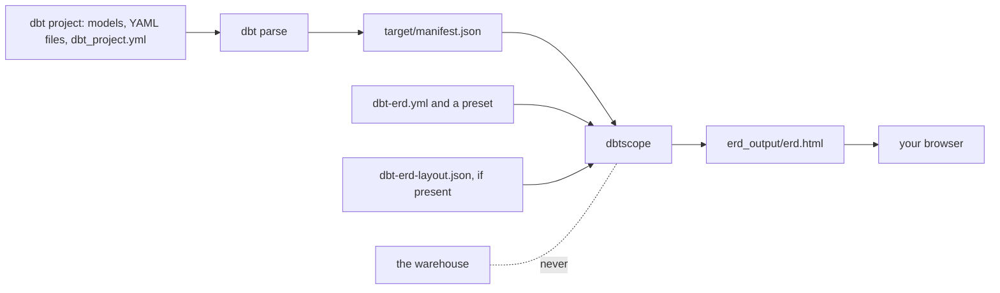
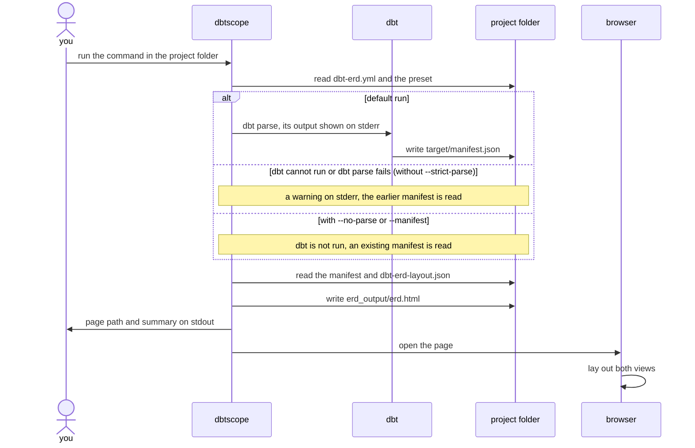
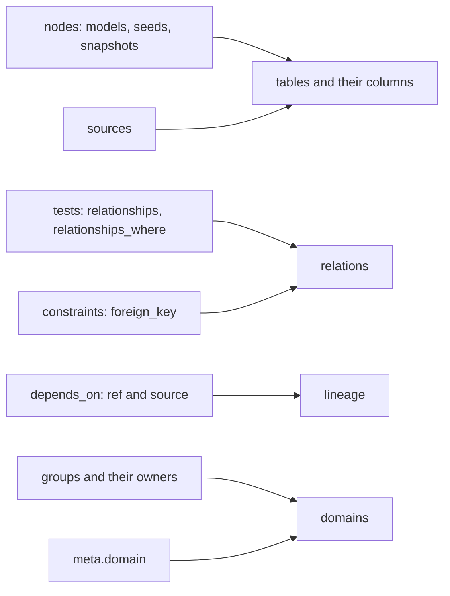
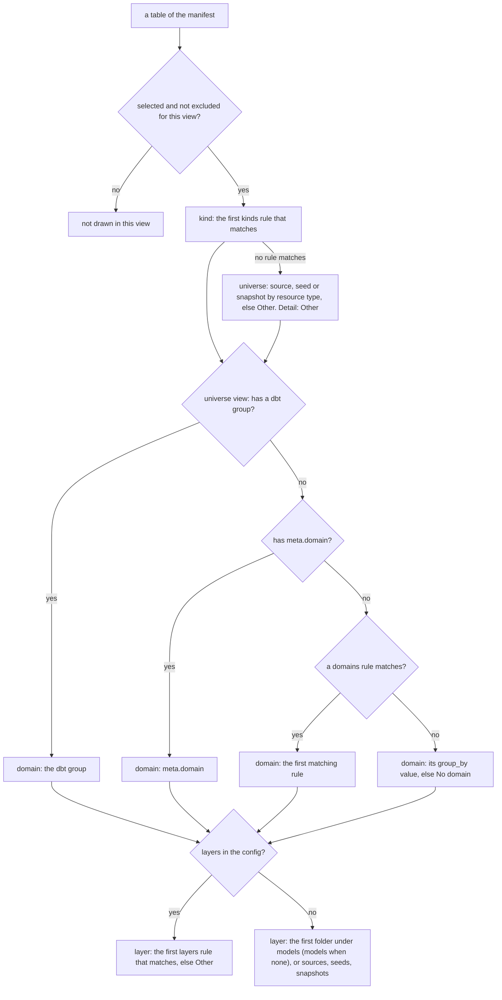
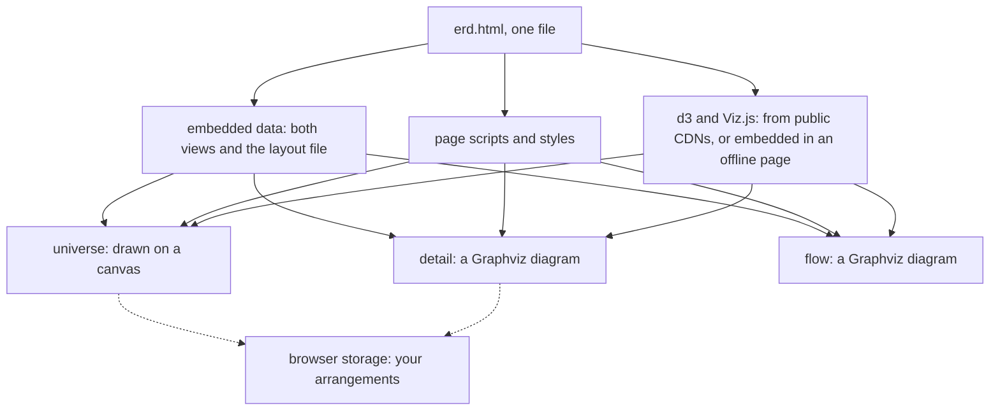
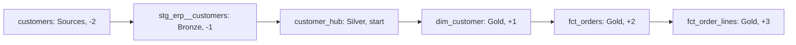
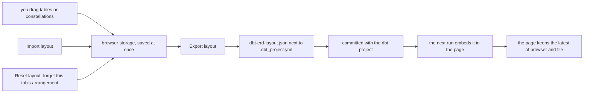

# How dbtscope works

For readers who want to understand what dbtscope does with their dbt project: curious users, reviewers, security and platform teams. It explains the run, what is read, how tables are classified and what the page holds, without code. How to install and use it: the [user guide](user-guide.md). The code itself (modules, layers, the responsibility map): [architecture.md](architecture.md).

## The big picture

dbtscope reads what dbt already knows about your project, the **manifest**, and turns it into one HTML page. It never talks to the warehouse.

`dbt parse` is the only dbt command run. It reads the project files and your profile, and connects to nothing. The manifest it writes holds every model, source, seed and snapshot, their columns and descriptions, the tests and constraints declared on them, and which table reads which.

## One run, step by step

- **Two streams.** The result goes to stdout: the absolute path of the page on the first line, then a summary. Everything else goes to stderr: progress, the output of `dbt parse`, warnings and errors. A script can read the page path from stdout and ignore the rest.
- **The page is never left half-written.** It is first written to a temporary file next to its destination, flushed to disk, then renamed over the old page in one step. If the run fails or is interrupted, the previous page is still there, whole.
- **One line per failure.** A problem stops the run with one line naming the file or option at fault and what to do, and an exit code. The list: [user guide § Troubleshooting](user-guide.md#troubleshooting).

## What is read from the manifest

| Manifest part | What it becomes |
|---|---|
| Models, seeds, snapshots (`nodes`) and `sources` | tables, identified by their dbt `unique_id` |
| Each table's name, description, schema, database, package, file path, tags | what the page shows and what selectors match (`schema:`, `path:`, `tag:`…) |
| Each column's name, `data_type` and description | the columns of the cards and of the detail view; a column without `data_type` is shown without a type |
| `relationships` tests, and dbt_utils `relationships_where` tests | relations: the tested column refers to the `to` table's `field` |
| `foreign_key` constraints of model contracts, at column or model level | relations, like the tests |
| `depends_on` of each table (what `ref` and `source` produce) | lineage: which table reads which |
| `group` of a table (also under `config:`) and the project's groups with their owners | the table's domain; the owner shows on hover |
| `meta.domain` of a table (also under `config:`) | the table's domain when it has no dbt group |
| The package of each table | only tables of your own project are drawn, unless `include_packages: true` |

What is **not** read: the SQL of your models, run results, `catalog.json`, the warehouse, and any data. A table without a test or a constraint is drawn without relations, even if the warehouse has a foreign key: the manifest is the only source.

## How a table is classified

Each view first decides which tables it draws (its **scope**), then gives each table a kind; the universe view also gives it a domain and a layer, the detail view a group. Every rule is a list of selectors; **the first rule that matches wins**. Selectors and rules are written in `dbt-erd.yml` ([user guide § Configuration](user-guide.md#configuration)).

- **Scope.** The detail view draws the tables matched by `select` and not by `exclude` (by default every model). The universe draws `universe.select` minus `universe.exclude` (by default every model, source, seed and snapshot). Both leave out the tables of installed dbt packages unless `include_packages` is `true`.
- **Kind.** The first `kinds` rule that matches gives the kind and its colour. In the universe, a table no rule matches is typed by its resource type (Source, Seed, Snapshot), else "Other"; in the detail view it is "Other". The page calls kinds "Types".
- **Domain** (universe view). A table's domain is the first of: its dbt **group**; its **`meta.domain`**; the first matching **`domains`** rule of the config; its **`group_by`** value (the schema by default). A table with none of these is in "No domain". Declaring dbt groups is the cleanest way to get business domains without any config. This order is decision D-015.
- **Layer** (universe view). With `layers` in the config, the first matching rule gives the layer, and a table no rule matches is in "Other". Without `layers`, a table's layer is the first folder under `models/` (sources, seeds and snapshots each form their own), and a model directly under `models/` is in the layer `models`. Layers are ordered along the usual data flow by the start of their name: `source`, then `raw` / `stg` / `staging` / `base`, then `seed` / `ref`, then `int` / `intermediate` / `vault` / `snapshot`, then `dp` / `mart` / `marts` / `product`, then any other name, then `report` / `expo`; layers of the same rank are sorted alphabetically. So the example project without its `layers` rules would show Sources, Seeds, Snapshots, its five `bronze_*` folders, then `gold` before `silver`: name layers that do not follow this order with `layers` rules.
- **Group** (detail view only). The detail view shows one group at a time: the table's schema by default, or its database, package, folder, a tag, or nothing, as `group_by` says.

## What the page contains

- **One file.** The page is a single HTML file: its styles, its scripts, and the data of both views as one block of JSON. Python prepares that data; the browser does all the drawing and layout, again on every filter change.
- **Structure only.** The data holds table and column names, types, descriptions, relations, lineage and the classification above. Never rows, never query results.
- **Libraries.** The page uses two JavaScript libraries: d3 (zoom, the universe's domain placement) and Viz.js (Graphviz compiled for the browser, for the detail and the flow). They come from public CDNs, or from the page itself when it is built offline: see [An offline page to share](user-guide.md#an-offline-page-to-share). Their versions, sources and licences: [src/dbtscope/render/vendor/README.md](../src/dbtscope/render/vendor/README.md).
- **Safe embedding.** Every `<` in the embedded data is written as an escape, so a description holding HTML can never break out of the data block.
- **Arrangements.** Tables and constellations you drag are saved in the browser's local storage, under a key built from the page title. See [The layout file's life](#the-layout-files-life).

## How each view is laid out

- **Universe.** Each domain is a circle. Inside it, tables sit in **layer bands**, left to right along the data flow, and the circle is the smallest that holds them; names and cards never overlap. The domains themselves are placed by a force simulation with a fixed seed, so the same project gives the same picture at every generation (decision D-040). With the **Constellations** switch on **Layers**, each circle is a layer instead, placed along the data flow, and its tables sit in domain bands tinted in the domain's colour (decision D-048). The whole universe is drawn on a canvas, which stays fast with about 1,500 tables.
- **Detail.** Graphviz draws the entity-relationship diagram of the selected group: referenced tables on the left, the tables that point at them on the right (hubs, then links, then satellites; dimensions, then facts).
- **Flow.** The flow of a trajectory is drawn by Graphviz from left to right. Its columns come from the lineage first, so every arrow points right; the layers are a floor, so sources, staging, vault and marts form bands where the lineage follows them. A flow holds at most 150 tables (decision D-036).

A real trajectory of the example project, as the flow draws it: the start `customer_hub`, both directions, all levels. `dim_customer` and `fct_orders` are both gold marts, but `fct_orders` reads `dim_customer`, so it stands one column further right.

## The layout file's life

An arrangement lives first in your browser. To share it, export it, commit the file next to `dbt_project.yml`, and every page generated afterwards carries it. When a page opens, it compares the arrangement saved in the browser with the one embedded from the file and keeps whichever was saved last. The file's name and format (`dbt-erd-layout.json`, format `dbt-erd-layout`, version 1) are stable: pages and projects of earlier versions keep working (decision D-013).

## What never happens

- **No warehouse connection.** dbtscope runs `dbt parse` and nothing else (decision D-012); `dbt parse` reads your profile and connects to nothing.
- **No credentials read by dbtscope.** It reads `dbt_project.yml`'s folder, the manifest, `dbt-erd.yml`, a preset file and `dbt-erd-layout.json`. Only dbt reads `profiles.yml`.
- **No data.** The page holds structure only: names, types, descriptions. No rows, no query results, no samples.
- **No network while generating.** The libraries of the offline page ship inside dbtscope, so building any page needs no network.
- **No other file written.** dbtscope writes the page and nothing else. `dbt parse` writes its own `target/` and `logs/` folders, as it always does.
- **No server.** The page is a file opened by your browser. Only a page built without `--offline` loads two libraries from public CDNs when it is opened.

## Further reading

- [architecture.md](architecture.md): modules, layers, the responsibility map and the glossary (for contributors).
- [decisions.md](decisions.md): why it is built this way, decision by decision.
- [ui-spec.md](ui-spec.md): every behaviour of the page, in detail.
